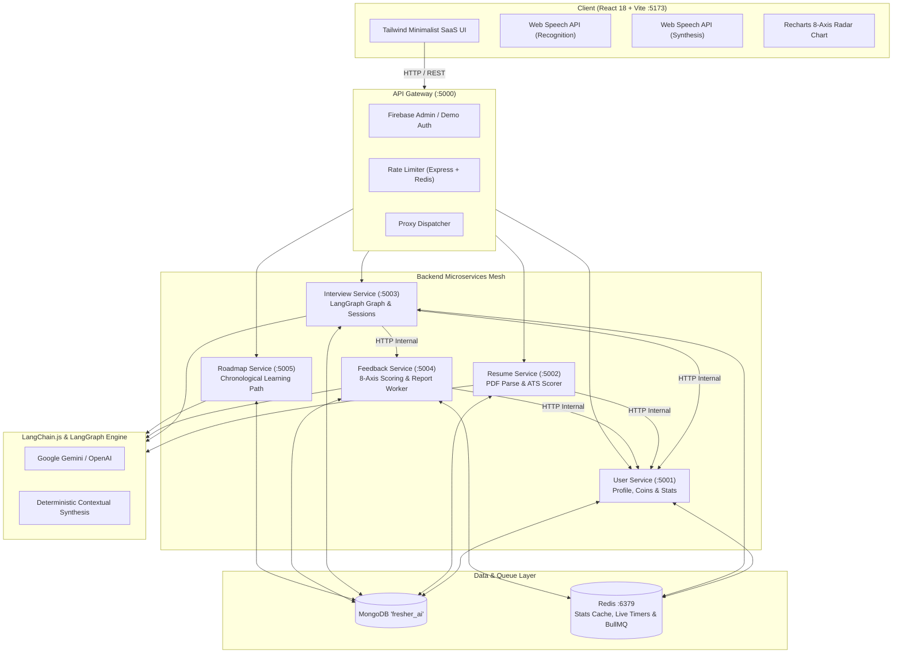

# Fresher.AI — Multi-Agent AI Interview Preparation Platform

> *"Job Interviews Don't Have to Suck Anymore!"*  
> **Designed & Developed by Kisara Harini**

Fresher.AI is a full-stack, microservices-driven multi-agent AI interview preparation platform built specifically for college students and fresh graduates. Four specialized AI agents collaborate across every stage of the hiring pipeline:
- **Resume Agent**: Analyzes resumes against ATS algorithms, detects roles, scores profiles, and writes high-impact bullet points.
- **Interview Agent**: Conducts realistic 6-question Technical and HR mock interviews using adaptive LangGraph workflows, real-time voice speech recognition, and question-by-question speech synthesis.
- **Feedback Agent**: Scores every response across 8 distinct dimensions and orchestrates asynchronous BullMQ background workers to generate comprehensive evaluation reports.
- **Roadmap Agent**: Synthesizes personalized chronological learning milestones tailored to a candidate's target role, salary goal, and resume gaps.

---

## 1. System Architecture Diagram



---

## 2. Tech Stack Summary

- **Frontend**: React 18, Vite (port `5173`), Tailwind CSS, React Router v6, Recharts (spider radar charts), Lucide React, Axios, Firebase JS SDK.
- **Backend**: Node.js microservices (ES Modules), Express.js, Mongoose, Multer, `pdf-parse`, Zod validation, Helmet, CORS, `express-rate-limit`, `http-proxy-middleware`, `firebase-admin`.
- **AI & State Machines**: LangChain.js, LangGraph.js, Google Gemini (`@langchain/google-genai`), OpenAI switchable via `LLM_PROVIDER`, strict Zod JSON schemas with retry on invalid output.
- **Database**: MongoDB (`fresher_ai` shared database with isolated microservice domain collections).
- **In-Memory Cache & Queues**: Redis (`ioredis`), BullMQ (`report-generation` worker queue).
- **Voice & Media**: HTML5 `getUserMedia` for local video mirror, Browser Web Speech API (`SpeechRecognition` and `speechSynthesis`).

---

## 3. Step-by-Step Setup Guide for Beginners

### Prerequisites
- Node.js `v18+` or `v20+` (tested on Node `v22`).
- npm `v9+` or `v10+`.
- (Optional) Docker & Docker Desktop for containerized deployment.

### 1. How to get a Google Gemini API Key (Free)
1. Visit [Google AI Studio](https://aistudio.google.com/).
2. Sign in with your Google Account.
3. Click **"Get API key"** in the top navigation bar.
4. Click **"Create API key in new project"** and copy your key.
5. Paste it in your `.env` file under `GEMINI_API_KEY`.

*(Note: If you run Fresher.AI without a Gemini API key or offline, the built-in AI Synthesis Fallback Engine automatically generates realistic mock interview questions, ATS resume scores, and performance feedback!)*

### 2. How to set up Firebase Authentication (Optional for Google Sign-in)
Fresher.AI comes with an **instant 1-click Demo Student login** that works immediately without any external configuration. To enable real Google accounts:
1. Go to the [Firebase Console](https://console.firebase.google.com/).
2. Click **Add Project** and name it (e.g. `fresher-ai`).
3. Under **Build**, select **Authentication** and click **Get Started**.
4. In the **Sign-in method** tab, enable **Google**.
5. In **Project Settings** (gear icon), under **Your apps**, click the web icon `</>` to register a web app and copy your `firebaseConfig` keys into `.env`.

---

## 4. Running the Application

### Option A: Single Command Run (Without Docker)
Ensure root and service dependencies are installed, then run:

```bash
# 1. Clone & Enter Directory
cd "c:/Users/harin/OneDrive/Desktop/fresher ai"

# 2. Run All 6 Microservices and the Client Concurrently
npm run dev
```

This launches:
- **Client**: `http://localhost:5173`
- **API Gateway**: `http://localhost:5000`
- **User Service**: `http://localhost:5001`
- **Resume Service**: `http://localhost:5002`
- **Interview Service**: `http://localhost:5003`
- **Feedback Service**: `http://localhost:5004`
- **Roadmap Service**: `http://localhost:5005`

### Option B: Docker Compose Run
If you have Docker installed:

```bash
docker compose up --build
```

---

## 5. College Presentation Demo Script

Use this 5-minute step-by-step walkthrough during your evaluation:

1. **Introduction & Landing Page (1 min)**:
   - Navigate to `http://localhost:5173`.
   - Point out the clean monochrome SaaS design system and tagline *"Job Interviews Don't Have to Suck Anymore!"*.
   - Show the **Product Preview card** below the hero: explain that it's a real React component showcasing the 8-axis spider radar charts.
   - Explain the 4 specialized AI agents working as a cohesive multi-agent mesh.

2. **Zero-Setup 1-Click Login (30 sec)**:
   - Click **"Get started for free →"**.
   - Click **"Continue as Demo Student (Kisara Harini)"**.
   - Show that this logs in as *Kisara Harini* and syncs with the user service instantly.

3. **Dashboard & Radar Charts (1 min)**:
   - Point out the 4 dark stat cards (Total Interviews, Questions Solved, Completed, Average Score).
   - Walk through the two spider radar charts:
     - **Technical Interviews** (Average of Correctness, Clarity, Relevance, Detail, Efficiency, Communication, Problem Solving, Creativity).
     - **HR Interviews**.
   - Click the round `+` on the **Interview Coins** card in the sidebar to demonstrate the coin top-up modal and balance updates.

4. **Resume Scorer (1 min)**:
   - Click **"Resume Scorer"** in the sidebar.
   - Upload any PDF resume. Click **"Analyze"**.
   - Show the score ring (purple for strong, amber for average, red for weak).
   - Highlight the detected role, strengths, weaknesses, missing skills, and actionable recommendations.

5. **Live AI Interview Room (1.5 min)**:
   - Click **"+ Create Interview"**. Choose *"Backend Developer"*, toggle *"Technical"*, and toggle *"Use Resume"*. Notice the green *"Resume Ready"* confirmation.
   - Click **"Start Interview →"** (deducts 50 coins).
   - In the live room:
     - Listen as the AI interviewer reads the question aloud via text-to-speech.
     - Show the animated **"AI Speaking"** badge.
     - Turn on the microphone (Web Speech API) or type an answer.
     - Click `</>` to open the monospace code editor, write a quick snippet, and submit using <kbd>Ctrl</kbd> + <kbd>Enter</kbd>.
     - Point out the 60s server-side countdown timer ring.
     - Show the instant **AI Feedback** box before the next question loads.

6. **Interview Performance Report (1 min)**:
   - Navigate to the completed interview report (`/interview/:id/report`).
   - Review the AI executive summary, strengths, areas to improve, and the 6 question score tiles.
   - Click **"Download PDF"** to demonstrate the dark-theme print stylesheet.

7. **Roadmap Builder (30 sec)**:
   - Go to **"Roadmap Builder"** in the sidebar.
   - Click quick-pick **"Frontend Dev"**.
   - Expand any module accordion to show the learning topics, duration, difficulty badge, and free learning resources.

---

## 6. Assumptions & [INFERRED] Decisions

As required by the project specifications, the following design and architectural decisions were inferred with sensible defaults:

1. **Dashboard Recent Interviews List**: Added below the spider radar charts so users have a clear interface to revisit past interview sessions and view completed reports.
2. **Add Coins Modal**: Connected to the `+` icon on the sidebar coins card. Provides free demo top-ups (+200, +500, +1000 coins) via `POST /api/me/coins/add`.
3. **Resume Scorer Score Bands**:
   - `< 40`: Weak (Red ring)
   - `40 – 59`: Below Average (Amber ring)
   - `60 – 79`: Average (Amber/Orange ring)
   - `80 – 100`: Strong (Purple ring)
4. **Interview Cost & Initial Balance**: Each mock interview costs 50 coins. New users start with 1,000 complimentary coins (enough for 20 full mock interviews).
5. **Interview Question Difficulty Progression**: In every 6-question interview, questions follow a realistic difficulty ramp:
   - Q1 – Q2: Easy (Foundations & Definitions)
   - Q3 – Q4: Medium (Component/API Architecture & Concurrency)
   - Q5 – Q6: Hard (Coding Algorithms & Distributed System Design)
6. **Blank / Timed-Out Answer Contract**: When the 60-second timer hits 0 without an answer, the server records:
   - `answer`: *"No answer provided. Time over."*
   - `scores`: All 8 metrics set to `0`.
   - `feedback`: *"No answer was provided, so it's impossible to assess the candidate's knowledge."*
   - `improvements`: `["Provide an answer."]`.
7. **Roadmap Module Accordion Details**: Expanding each module displays a detailed description, specific sub-topics to master, and curated free learning resources (MDN, freeCodeCamp, roadmap.sh).
8. **Resume Builder (`/resume-builder`)**: Built as a multi-step tabbed wizard (Personal Info, Education, Skills, Projects, Experience, Certifications) with an AI *"Generate with AI"* button that converts raw descriptions into quantifiable ATS bullet points, paired with a live single-column A4 print-ready preview.
9. **Zero-Setup Academic Demo Mode**: In addition to standard Firebase Auth, a 1-click *"Demo Student"* login button enables instant evaluation without needing external API credentials or databases. If MongoDB or Redis is offline, the services seamlessly switch to in-memory persistence.

---

## 👤 Author & Project Creator

**Kisara Harini**  
*College Academic Capstone / Major Project*  
Full-Stack Multi-Agent AI Interview Preparation System (Fresher.AI)


